<div align="center">

# TrueUnit

<a href="https://trueunit.hayyan.space"></a>
<a href="https://trueunit.hayyan.space/assistant?demo=1"></a>

### Fewer, better decisions for people renting or buying in Dubai

A personal assistant for people searching a Dubai property portal. It checks the ads before you spend a call,<br>
asks every agent only what their ad doesn't say, and puts every answer in one place.<br>
**The agent stays in the deal.**

**[Open the live prototype →](https://trueunit.hayyan.space)** &nbsp;·&nbsp; [60-second demo](https://trueunit.hayyan.space/assistant?demo=1) &nbsp;·&nbsp; [One-pager](ONE-PAGER.md) &nbsp;·&nbsp; [Source on GitHub](https://github.com/Hayyan612/pf-trusted-search)

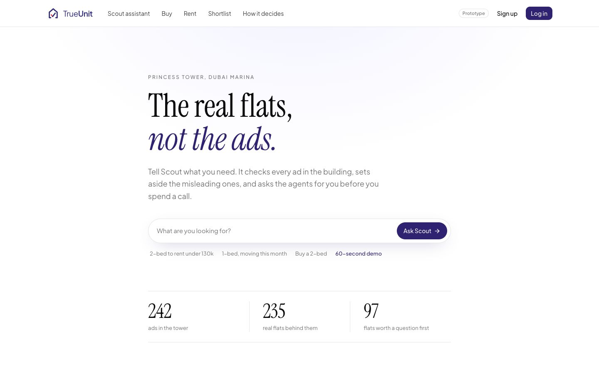

</div>

---

## What I found in one tower

I pulled all **242 live ads** in Princess Tower, Dubai Marina (144 rent, 98 sale) on 25 Nov 2026, let code group repeats and match photos, then checked 32 by hand.

| | |
|---|---|
| **98 of 242** | ads need a question before they're worth a call: stale, also for sale, "tenanted" in the small print, holiday-home pricing |
| **6 of 6** | ads that share photos with an ad of a different size carry the **Verified** badge |
| **8%** | the typical rental ad asks above what the same size actually rented for (DLD records via DataGuru) |
| **0 of 144** | rental ads say whether chiller is included |

Full evidence in [AUDIT.md](AUDIT.md), the rules and where each one is wrong in [RULES.md](RULES.md).

---

## The product

### 1. Tell Scout what you need, and it asks the agents for you

<table>
<tr>
<td width="25%">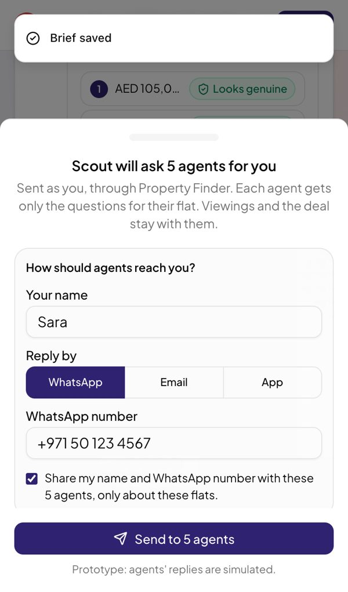<br><sub><b>Nothing goes out without you.</b> Name, how to reply, and consent at the moment of sending.</sub></td>
<td width="25%">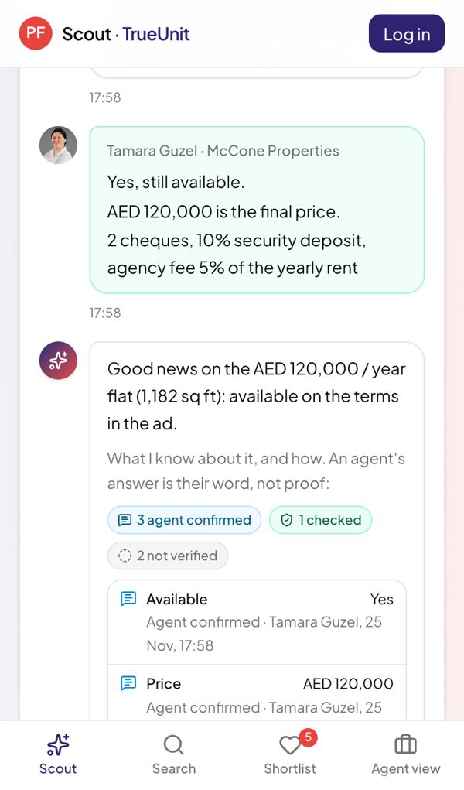<br><sub><b>Answers come back into one thread.</b> Every fact is marked agent confirmed, checked, not verified, or conflicting.</sub></td>
<td width="25%">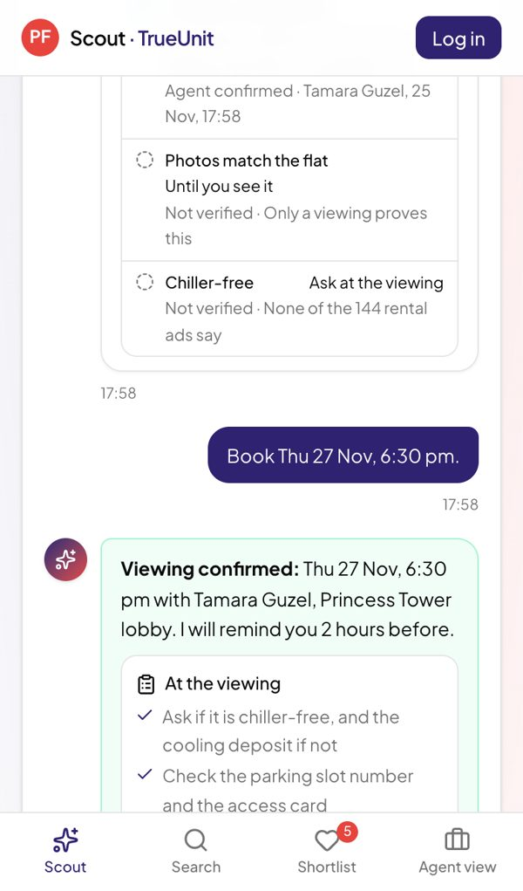<br><sub><b>Book a viewing in one tap</b>, with a checklist of what to check on the day.</sub></td>
<td width="25%">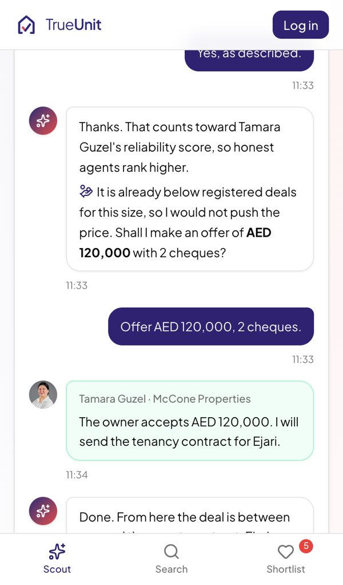<br><sub><b>After the viewing:</b> was it as described? Then an offer grounded in registered deals.</sub></td>
</tr>
</table>

### 2. Ask Scout, right beside the listing

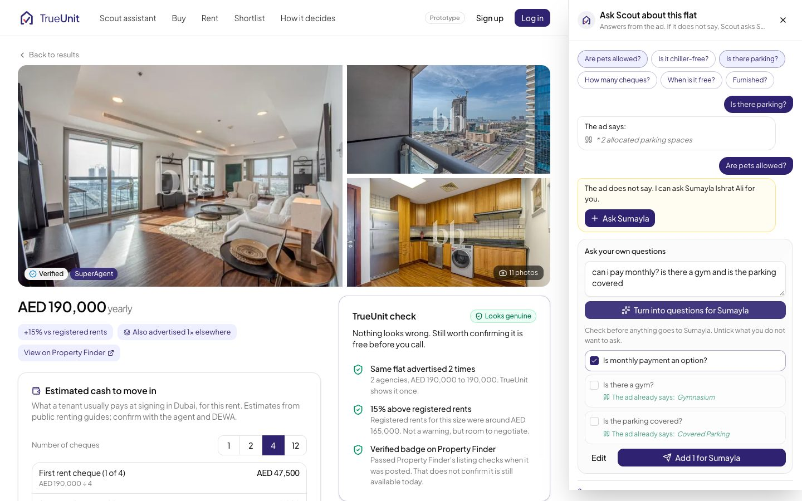

Read the ad and ask at the same time. One-tap questions are answered **from the ad itself, with a quote**. Type your own questions, several at once: Scout rewrites them for the agent, flags the ones the ad already answers, and you pick what to send.

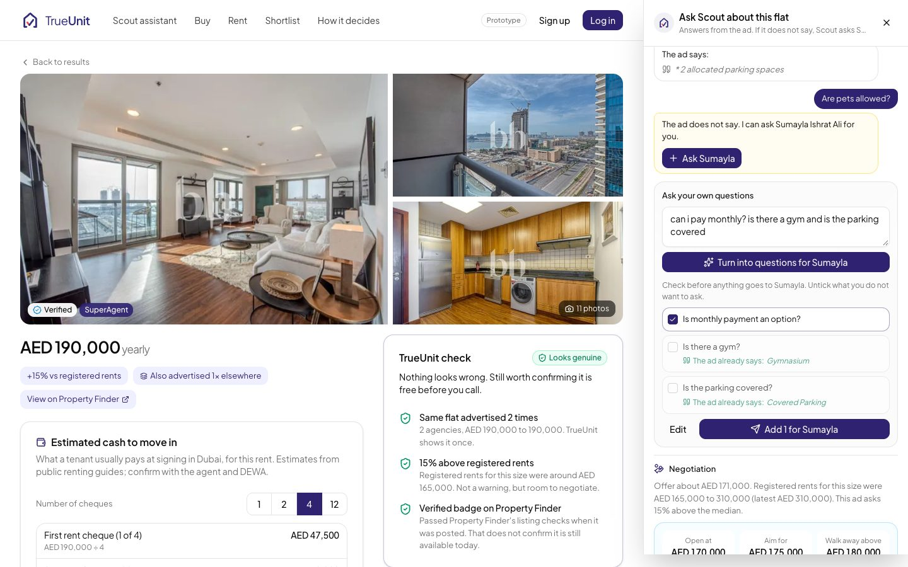

**Negotiation brief:** an opening offer, a target and a walk-away price, built only from registered deals and other ads in the tower, plus a message ready to send.

### 3. Search that shows real flats, not ads

<table>
<tr>
<td width="50%">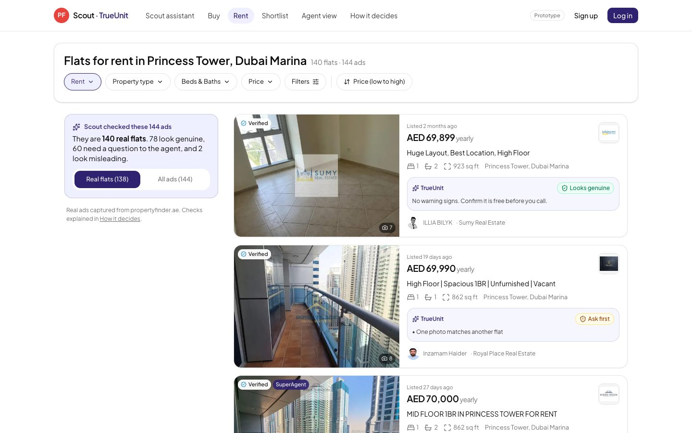<br><sub><b>"144 ads, 140 real flats."</b> Repeats are grouped; likely misleading ads are folded away with the reason.</sub></td>
<td width="50%">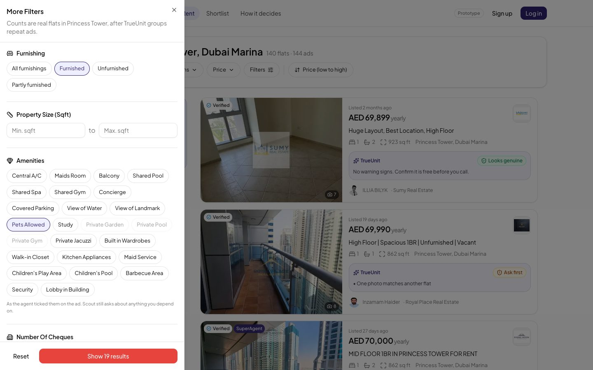<br><sub><b>Familiar portal filters and wording</b>, with a live count of real flats.</sub></td>
</tr>
</table>

### 4. On your phone

<table>
<tr>
<td width="33%">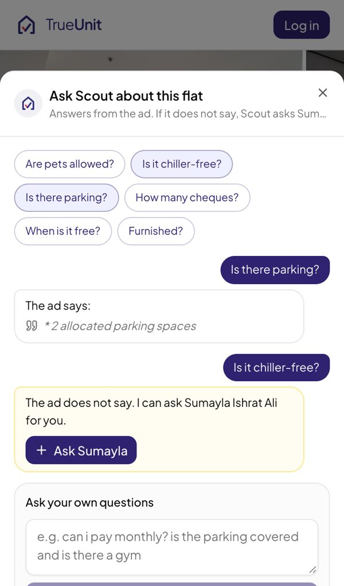<br><sub>Ask Scout as a bottom sheet.</sub></td>
<td width="33%">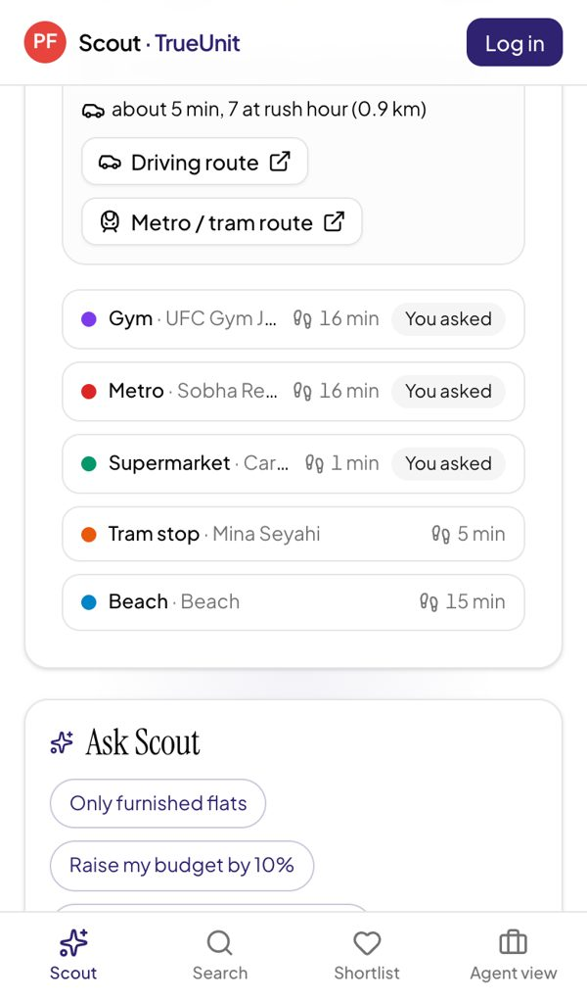<br><sub>Your commute, and the gym, metro and supermarket you asked about.</sub></td>
<td width="33%"></td>
</tr>
</table>

---

## Try it

- **60-second demo:** [/assistant?demo=1](https://trueunit.hayyan.space/assistant?demo=1) loads an example brief, then tap **Ask all 5 agents** and watch the replies come in (simulated, and labelled so).
- **Renter:** "2-bed to rent under 130k a year, furnished, moving in January, I have a cat"
- **Buyer:** "Buy a 2-bed to rent out, budget 2.5 million"
- **New to Dubai:** "Moving to Dubai from London in January, 1-bed to rent under 100k" shows Ejari, DEWA, cheques, chiller and the cash to move in.
- **Browse:** Rent, then open any listing and tap **Ask Scout**.

**Stack:** Next.js 15, React 19, Tailwind v4, shadcn/ui, Motion, Vercel AI SDK with OpenRouter, Better Auth on Postgres, MapLibre with OpenStreetMap. Audit scripts in Python.

---

## How Scout works

| Part | Who decides | Why |
|---|---|---|
| Reading the person's words into a brief | An LLM (Vercel AI SDK, OpenRouter, structured output). Falls back to built-in rules without a key. | Language is what LLMs are good at. The brief is shown back and editable. |
| Follow-up questions for missing essentials | Code (`missingEssentials`) | Ask only what is missing: budget, bedrooms, move-in, who is moving / live-in or invest / cash or mortgage. |
| Which ads are misleading, and the trusted top 5 | Deterministic rules (`scripts/build_data.py`, `lib/match.ts`) | Explainable and repeatable. The model never judges trust. |
| What to offer | Code (`lib/negotiate.ts`) from registered deals | A suggestion grounded in what the same size actually rented or sold for |
| Location: map, commute, what is nearby | MapLibre GL + OpenFreeMap tiles; places from OpenStreetMap (Overpass), live with a saved fallback; car times are estimates with Google Maps links for exact routes | The person's priorities (gym, metro, office) shown on a real map |
| Message to each agent | Code (`lib/message.ts`) from the brief, the flat's open questions and the suggested offer | Readable, copyable, the person sees exactly what is sent |
| Chat ("only furnished", "why is #1 top?") | The LLM picks from 5 tools; each result renders as a shadcn component filled from real data | Generative UI without letting the model invent a listing or price. |
| Contacting agents | The person, after adding contact details and ticking consent | Nothing is sent without a tap. |
| Questions on a listing (Scout panel beside the ad) | Code answers one-tap questions from the ad text with a quote. Free-text questions: the LLM splits and rewrites them and may quote the ad; every quote is checked against the ad text in code (`lib/custom-questions.ts`) | Answer from the ad before bothering the agent; the person picks what is sent |
| Negotiation brief | The LLM, given only registered deals, other ads and TrueUnit's checks; code rejects numbers out of order; rules fallback (`lib/negotiation-brief.ts`) | Saves money with evidence, cannot invent a price |
| What is known about each flat | Code (`lib/facts.ts`): agent confirmed, checked (data or a viewing), not verified, conflicting | An agent's answer is their word, not proof |
| Agent replies, nudges, viewing confirmations, offer answers | **Simulated** in the browser (`components/agent-simulator.tsx`) and labelled so | Shows the full loop; the real version needs the portal's lead inbox |

## Accounts (optional)

Everything works as a guest: the brief, shortlist and contact details stay in the browser. Signing up (email and password, or Google) saves the brief, shortlist and agents' answers to the account, so a search started on a laptop continues on a phone. The newer copy wins when you sign in.

- Auth: Better Auth on Postgres. Tables are created on first use (`lib/db.ts`); `/api/health` reports the database state.
- Sync: `GET/PUT /api/shortlist` and `GET/PUT /api/brief`.
- Google sign-in turns on with `GOOGLE_CLIENT_ID` and `GOOGLE_CLIENT_SECRET`. Scout's AI turns on with `OPENROUTER_API_KEY` (model: `ASSISTANT_MODEL`, default `google/gemini-2.5-flash`).

## Docs

- [ONE-PAGER.md](ONE-PAGER.md): the problem, where it lives, metrics, the test, what is missing
- [AUDIT.md](AUDIT.md): all 242 ads checked, 92 listed one by one with links, plus 32 checked by hand
- [RULES.md](RULES.md): 10 rules, where each one is wrong, and who gets hurt
- [AI-LOG.md](AI-LOG.md): 10 times the AI, or my own rules, got it wrong, how I caught it, and what changed
- [data/](data/): every ad as captured, and `app-data.json` with TrueUnit's call on each
- [DECISIONS.md](DECISIONS.md): decisions with times, and the research behind them

## How to run

```bash
pnpm install
cp .env.example .env.local   # DATABASE_URL, BETTER_AUTH_SECRET, BETTER_AUTH_URL; optional Google, OpenRouter, SMTP keys
pnpm dev                     # http://localhost:3000
```

Rebuild the data (needs `uv`):

```bash
uv run scripts/photos.py             # photo fingerprints for every ad
uv run scripts/photos_neighbours.py  # photos vs 343 ads in 8 neighbouring towers
uv run scripts/build_data.py         # checks, registered deals, real-flat grouping -> data/app-data.json
python3 scripts/write_audit.py       # AUDIT.md
```

## What is real and what is mocked

| Real | Mocked |
|---|---|
| All 242 ads: price, size, beds, photos, agent, agency, text, listing date, Verified badge, captured from a public Dubai property portal on 25 Nov 2026 (`data/raw/`) | Sending questions to agents, their replies, and viewing confirmation (simulated after a few seconds) |
| Every check and every reason shown (`scripts/build_data.py`) | |
| Nearby places from OpenStreetMap; commute by car as an estimate (distance x road factor, off-peak and rush-hour speeds) | Exact metro/tram times (link to Google Maps instead) |
| Expat guide figures (DEWA deposit, Ejari, 5% housing fee, deposit, agency fee, chiller) as ranges from public renting guides, linked in the app | |
| Registered rents and sales per size and price trends: the DLD records the portal shows via DataGuru (`data/raw/dataguru.json`) | Push notifications when an agent answers (described, not built) |
| Photo matches between ads, and against 343 ads in 8 neighbouring towers (perceptual hashes) | |
| The brief, follow-up questions, trusted top 5, contact and consent, accounts and sync (Postgres) | |

Stack: Next.js 15, shadcn/ui, Tailwind, Vercel AI SDK, OpenRouter, Better Auth, Postgres. Deployed with Docker on my own server (Dokploy).
